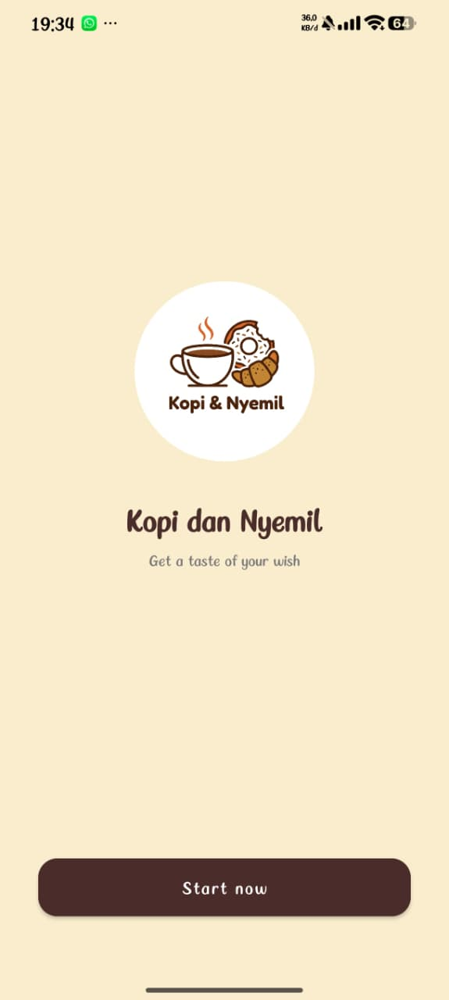
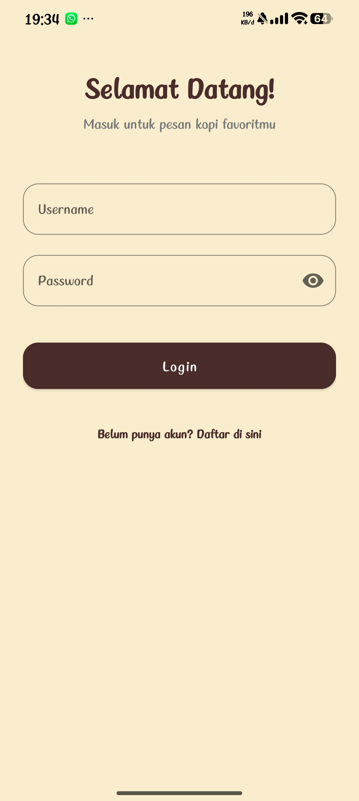
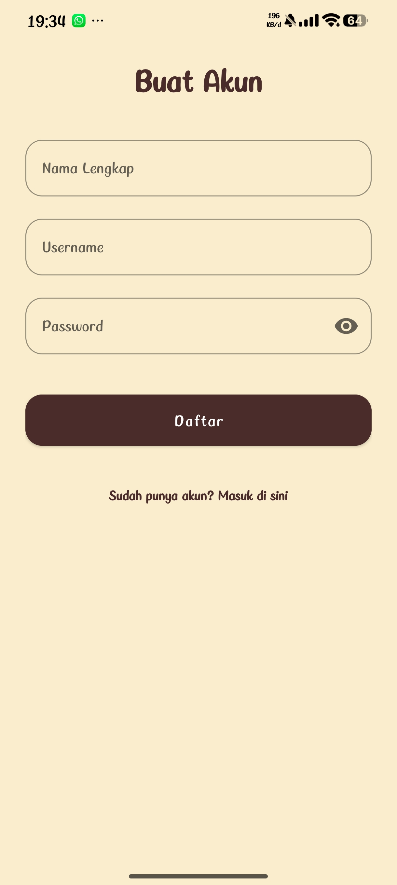
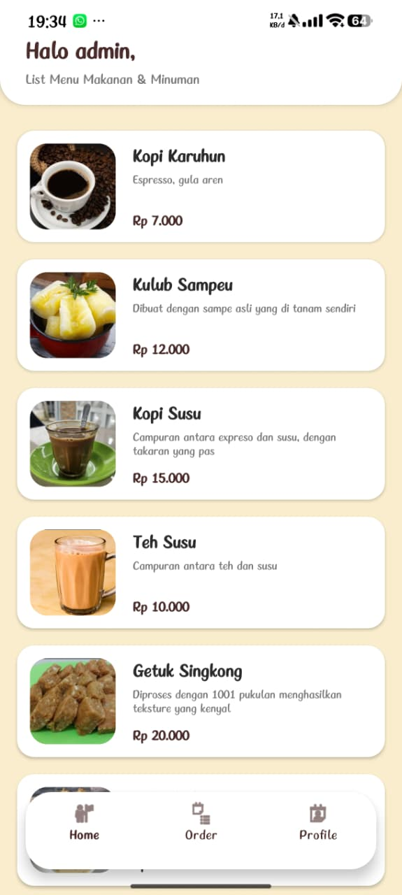
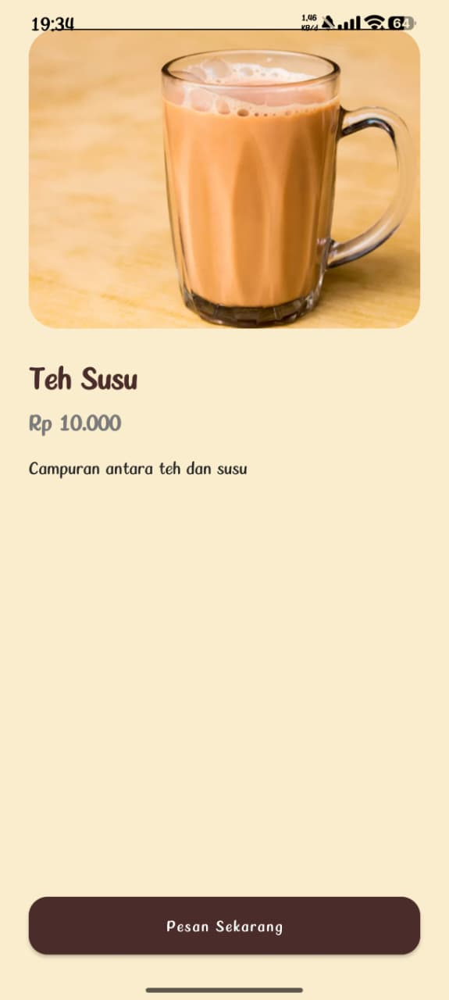
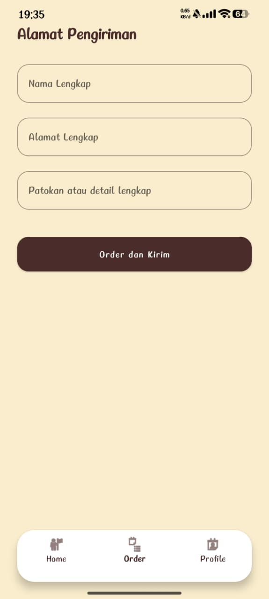
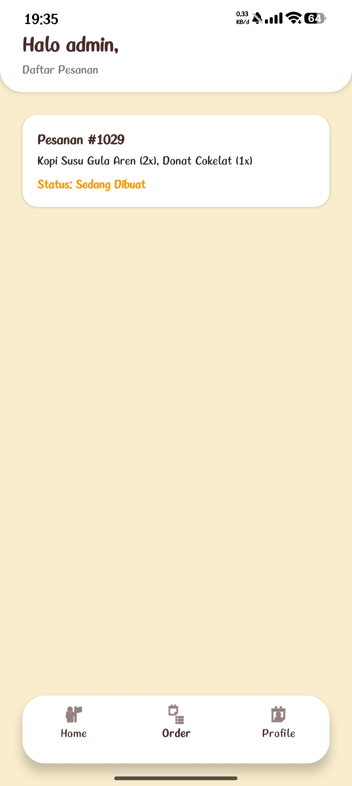
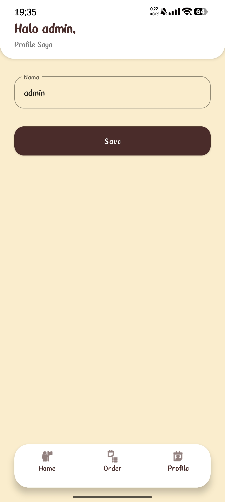
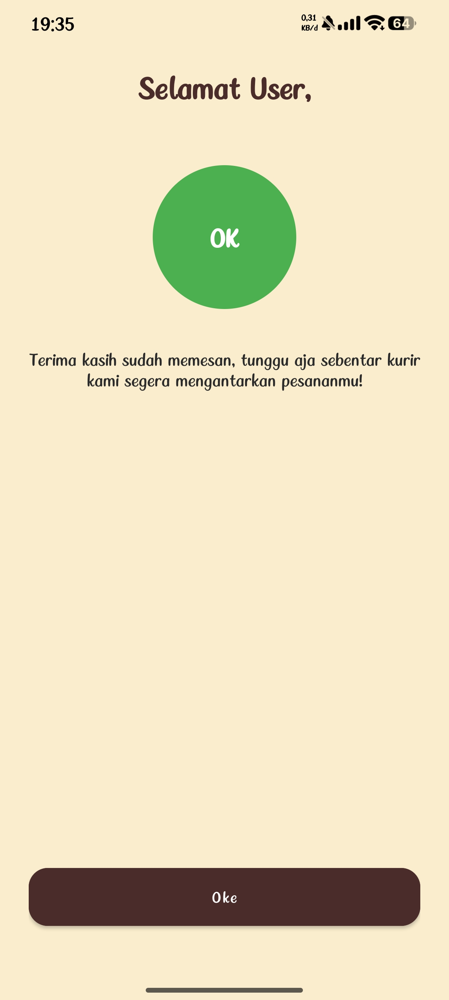

# Kopi dan Nyemil
**Develover : Aldi Pramana**

**Nim : 1247050031**

**Kopi dan Nyemil** adalah aplikasi mobile berbasis Android yang dirancang untuk mempermudah pengguna dalam memesan kopi dan camilan favorit mereka. Aplikasi ini dibangun menggunakan bahasa pemrograman **Kotlin** dan mengimplementasikan desain antarmuka (UI) modern dengan tema *Classic Coffee Shop* (warna earthy/hangat).

Proyek ini dibuat untuk memenuhi tugas mata kuliah Pemrograman Mobile. Aplikasi ini menggunakan data statis (*dummy data*) tanpa integrasi database eksternal, namun telah menerapkan penyimpanan lokal sederhana (*SharedPreferences*) untuk sesi pengguna.

## Fitur Aplikasi

Aplikasi ini memiliki alur lengkap dari awal hingga akhir, meliputi:
1. **Splash Screen**: Halaman pembuka dengan logo aplikasi.
2. **Login & Register**: Halaman autentikasi pengguna. *(Gunakan akun dummy: **Username:** `admin` | **Password:** `admin123`)*.
3. **Home**: Halaman utama yang menampilkan daftar menu kopi dan camilan (menggunakan `RecyclerView` dengan 6 item dummy) beserta harga dan deskripsi.
4. **Detail Produk**: Halaman yang muncul saat salah satu menu di Home diklik, menampilkan gambar produk yang lebih besar dan deskripsi lengkap.
5. **Checkout (Alamat Pengiriman)**: Form pengisian nama, alamat lengkap, dan patokan lokasi sebelum pesanan dikonfirmasi.
6. **Konfirmasi Pesanan**: Halaman sukses setelah pesanan dilakukan.
7. **Order History**: Halaman yang menampilkan daftar riwayat atau pesanan aktif (tab Order pada navigasi bawah).
8. **Profile**: Halaman untuk melihat dan menyimpan nama pengguna.
9. **Bottom Navigation**: Navigasi bawah bergaya *floating* (melayang) dengan sudut membulat untuk berpindah antara Home, Order History, dan Profile.
10. **Keamanan UI**: Aplikasi dikunci dalam mode *Portrait* (tidak bisa diputar landscape) dan dipaksa menggunakan *Light Mode* agar desain warna tetap konsisten.

## Teknologi yang Digunakan

*   **Bahasa Pemrograman**: [Kotlin](https://kotlinlang.org/)
*   **IDE**: [Android Studio](https://developer.android.com/studio)
*   **UI Toolkit**: XML Layouts, Material Design Components (MaterialCardView, TextInputLayout, MaterialButton).
*   **Komponen Android**: Activity, Intent (untuk perpindahan halaman & passing data), RecyclerView, SharedPreferences (untuk menyimpan sesi nama user), BottomNavigationView.

## Cara Menjalankan Aplikasi

1.  **Clone Repository**
    Buka terminal/Command Prompt dan jalankan perintah berikut:
    ```bash
    git clone https://github.com/allprmn/KopiDanNyemil.git


## Screenshot Aplikasi

| Splash Screen | Login | Register |
|:---:|:---:|:---:|
|  |  |  |

| Home (Daftar Menu) | Detail Produk | Form Alamat (Checkout) |
|:---:|:---:|:---:|
|  |  |  |

| Order History |                                         Profile                                          | Konfirmasi Pesanan |
|:---:|:----------------------------------------------------------------------------------------:|:---:|
|  |  width="200"> |  |